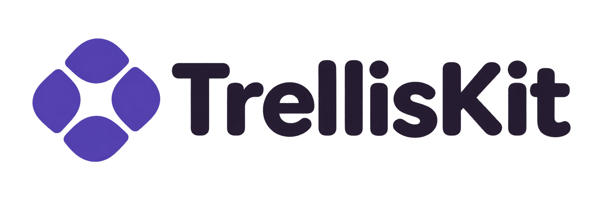

<p align="center">
  
</p>

# TrellisKit

**TrellisKit** is a reusable community and membership engine: a C# backend (REST and WebSocket API, workers), a website (marketing pages, web member app, admin console), an iOS and Android app, a local Docker stack, and AWS infrastructure as code. A **property** is one configured community that runs on the engine: its name, brand, copy, domains, legal text, profile taxonomy, reactions, and products. Deployments support one property by default or multiple isolated properties.

This standalone [TrellisKit repository](https://github.com/jchristn/TrellisKit) contains the engine and a neutral sample. Everything brand-specific lives in an external property folder and is selected by one setting, `TK_PROPERTY_DIR`. The binding specification is [docs/TRELLISKIT.md](docs/TRELLISKIT.md).

## Properties

| Folder | Property | Purpose |
|---|---|---|
| `samples/example/` | Example Community | The engine's neutral sample. Default when no property is selected; used by every engine test and CI job |

Real properties live outside the engine folder, each in its own folder or repository, and are selected with `TK_PROPERTY_DIR`. See "Adding a property" below.

## Repository layout

| Path | Contents |
|---|---|
| `backend/` | Engine backend (Watson 7, .NET 10): `TrellisKit.Core`, `TrellisKit.Server`, test hosts |
| `www/` | Engine website (React + Vite): marketing, member app, admin console |
| `mobile/` | Engine mobile and tablet app (React Native + Expo) |
| `shared/` | JavaScript shared by `www/` and `mobile/` (API client, enums, validators, property helpers) |
| `docker/` | Docker stack for one property: the server with the website (one container), PostgreSQL, RecallDB, Mailpit, Prometheus, Grafana, Tempo, Loki; `compose.yaml` runs the published images, `compose.dev.yaml` builds from source |
| `build-server.sh`, `build-www.sh`, `build-all.sh` (and `.bat`) | Publish `jchristn77/trelliskit-server` (server and website) and `jchristn77/trelliskit-www` (website only) for linux/amd64 and linux/arm64/v8, tagged `latest` plus the given tag |
| `infra/` | AWS infrastructure as code (CDK, C#), driven by the property |
| `assets/` | Engine assets: Grafana dashboards, Postman collection |
| `docs/` | Engine docs: architecture, API contracts, the TrellisKit specification |
| `samples/example/` | Neutral sample property |

An external property repository contains `property.json`, `brand/`, `web/`, `legal/`, `mobile/`, `server/settings.json`, and `deploy/`. It is not part of this repository.

## Selecting a property

`TK_PROPERTY_DIR` is the single selector (absolute, or relative to the engine root; default `samples/example`):

| Component | How the property is selected |
|---|---|
| Backend | Setting `property.directory` or env `TK_PROPERTY_DIR` |
| Website build | Env `TK_PROPERTY_DIR` |
| Mobile build | Env `TK_PROPERTY_DIR` (read by `app.config.js`) |
| Docker | Published images bake in a property (the engine's image bakes in the sample). From source: `TK_PROPERTY_DIR` in `docker/.env` (sample) or in the property's `deploy/local.env`, passed to `docker/dev.sh` |
| Infra | CDK context `-c propertyDir=<folder>`; the property's `deploy/infra.json` supplies account ids, alarm email, and the GitHub repository |

## Getting started

Run the whole platform with Docker:

```bash
cd docker
./update.sh                                   # the published image (sample property), pinned in compose.yaml
./dev.sh                                      # or build from source (sample property)
./dev.sh ../../<property>/deploy/local.env    # build from source for a real property
./factory/reset.sh                            # wipe every volume and start fresh
```

Publishing images (Docker Build Cloud, linux/amd64 and linux/arm64/v8):

```bash
./build-server.sh v1.0.0    # jchristn77/trelliskit-server:v1.0.0 and :latest (server and website in one image)
./build-www.sh v1.0.0       # jchristn77/trelliskit-www:v1.0.0 and :latest (website only)
./build-all.sh v1.0.0       # both
```

Then open http://127.0.0.1:8080 (website, API at `/api`, admin console at `/admin`, all from the server container) and Grafana at http://127.0.0.1:3000 (admin / admin). See [docker/README.md](docker/README.md) for every URL and credential.

Working on one component:

| Component | Commands | Docs |
|---|---|---|
| Backend | `cd backend/src && dotnet run --project TrellisKit.Server` | [backend/README.md](backend/README.md) |
| Website | `npm install` (repo root), then `npm run dev --workspace www` (http://127.0.0.1:5173, proxies `/api` to 127.0.0.1:8000) | [www/README.md](www/README.md) |
| Mobile | `cd mobile && npm install && npx expo start` | [mobile/README.md](mobile/README.md) |
| Infra | `cd infra && npx aws-cdk@2.1147.0 synth -c env=dev --no-lookups` (add `-c propertyDir=<folder>` for a property) | [infra/README.md](infra/README.md) |

Set `TK_PROPERTY_DIR` in the shell to work on a specific property, for example `TK_PROPERTY_DIR=../<property> npm run dev --workspace www`.

Tests (engine, sample property):

```bash
cd backend/src && dotnet run --project Test.Automated   # plus dotnet test Test.Xunit3 / Test.Xunit2 / Test.Nunit / Test.Mstest
npm test --workspace shared && npm test --workspace www
cd mobile && npm test
cd infra/src && dotnet test TrellisKit.Infra.sln
```

CI: `.github/workflows/tests.yml` runs every backend test host on Linux against PostgreSQL with pgvector, compiles the backend on Windows and macOS, and tests and builds the website, shared package, and mobile app. `infra.yml` tests the CDK app and synthesizes the sample property and shared deployment fixtures. Engine jobs use neutral fixtures. Each property builds its website, mobile bundle, and infrastructure in its own repository or workflow.

API reference: [REST_API.md](REST_API.md) and the Postman collection in [assets/postman/](assets/postman/).

## Adding a property

1. Copy `samples/example/` to a new folder (for example `<property folder>/`) and edit `property.json`: a unique `id` (lowercase letters, digits, hyphens, at most 20 characters), name, domains (the API and media hosts must be subdomains of the web domain), contact addresses, brand colors, profile taxonomy, reactions, membership product, and features. See section 2 of [docs/TRELLISKIT.md](docs/TRELLISKIT.md).
2. Replace `brand/logo.png`, `brand/icon.png`, and `brand/icon.ico`; add `web/theme.css`, `web/content/*.md`, `legal/*.md`, and the generated `mobile/` icons and splash.
3. Optionally add `server/settings.json` (server defaults seeded into the Docker stack on first start; never real secrets).
4. Add `deploy/local.env` (`TK_PROPERTY_DIR` relative to the engine's `docker/` folder, and `TK_PROPERTY_ID`) and `deploy/infra.json` (`accounts.dev`, `accounts.prod`, `alarmEmail`, `github.owner`, `github.repository`).
5. Add the property's own build scripts (a `build-server.sh` that builds `docker/server/Dockerfile` with `--target combined --build-context property=<property folder>`) and a deployment folder with a `compose.yaml` derived from `docker/compose.yaml` and pinned to its image.
6. Run it from source: `docker/dev.sh <property>/deploy/local.env`, and `npx aws-cdk@2.1147.0 synth -c env=dev -c propertyDir=<property> --no-lookups`.

No engine code changes are needed. If one seems to be, the engine is missing a configuration option: add the option to the engine (with a neutral default) instead of naming the property.

## AOT support

Not supported. API JSON uses reflection-based serialization, and the planned Stripe and Google Play client libraries depend on Newtonsoft.Json reflection. There is no `Test.Aot` project; the full suite runs on Linux, Windows, and macOS in CI.

## License

MIT. Copyright (c) 2026 Joel Christner. See [LICENSE.md](LICENSE.md).

## Reusable service extensions

The [integration guide](docs/INTEGRATION.md) covers durable jobs, worker-only harnesses, AI roles and prompt gates, content review and property email layouts. The [metrics contract](docs/METRICS_CONTRACT.md) explains registry extensions, declarative dashboards, alerts, privacy and aggregate retention. These capabilities use neutral engine defaults and property-owned configuration.
